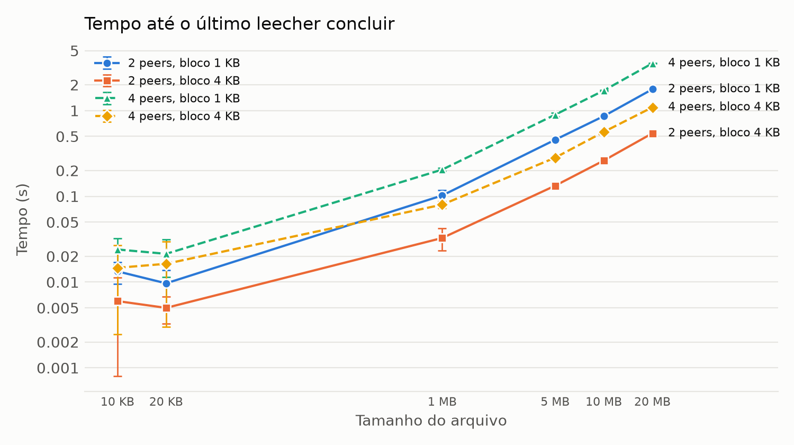
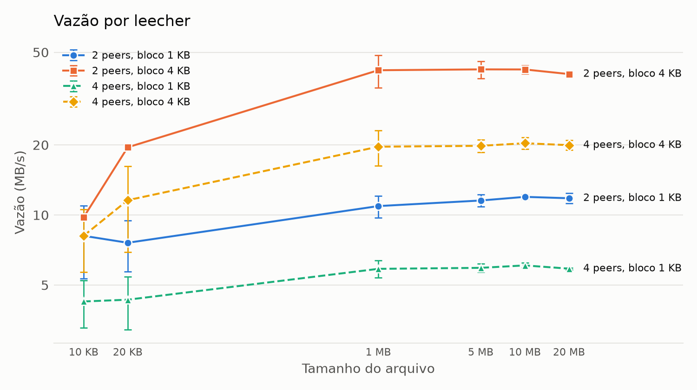
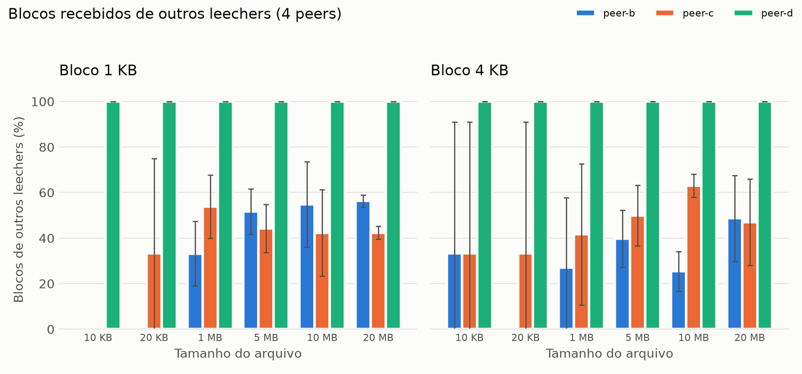
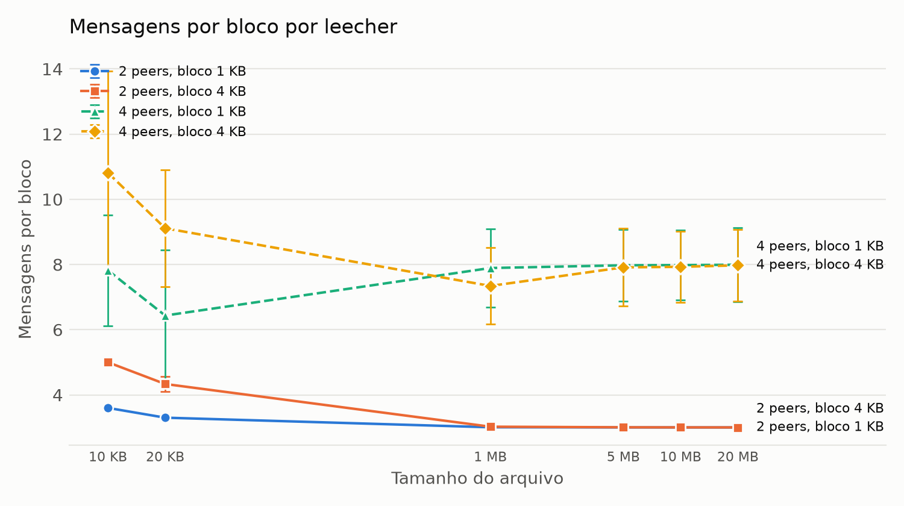

# Resultados dos estudos de caso

Matriz de 24 cenários (2 ou 4 peers × bloco de 1 KB ou 4 KB × 6 tamanhos de arquivo), 3 repetições cada, executados no Docker. 1 KB = 1024 bytes e 1 MB = 1024² bytes.

**Verificação:** 144/144 downloads de leechers aprovados em todas as checagens (SHA-256 e tamanho do arquivo remontado, origens apenas entre vizinhos configurados, blocos por origem nos logs iguais ao resumo, saída limpa dos containers).

## Métricas

- **Tempo por leecher:** do início do processo do leecher até o arquivo remontado e verificado.
- **Tempo do último leecher:** maior tempo entre os leechers de uma mesma execução.
- **Vazão:** tamanho do arquivo dividido pelo tempo desde o recebimento do metadado até a conclusão.
- **Blocos de outros leechers:** percentual de blocos que o leecher recebeu de outros leechers em vez do seeder.
- **Mensagens por bloco:** mensagens enviadas e recebidas pelo leecher divididas pelo número de blocos.

Valores em média ± desvio padrão.

| Peers | Bloco | Arquivo | Blocos | Tempo por leecher (s) | Tempo do último leecher (s) | Vazão (MB/s) | Mensagens por bloco | Verificação |
|---|---|---|---|---|---|---|---|---|
| 2 | 1 KB | A (10 KB) | 10 | 0.013 ± 0.004 | 0.013 ± 0.004 | 8.1 ± 2.8 | 3.60 ± 0.00 | 3/3 |
| 2 | 1 KB | A (20 KB) | 20 | 0.010 ± 0.004 | 0.010 ± 0.004 | 7.6 ± 1.9 | 3.30 ± 0.00 | 3/3 |
| 2 | 1 KB | B (1 MB) | 1024 | 0.102 ± 0.015 | 0.102 ± 0.015 | 10.9 ± 1.2 | 3.01 ± 0.00 | 3/3 |
| 2 | 1 KB | B (5 MB) | 5120 | 0.457 ± 0.025 | 0.457 ± 0.025 | 11.5 ± 0.7 | 3.00 ± 0.00 | 3/3 |
| 2 | 1 KB | C (10 MB) | 10240 | 0.862 ± 0.029 | 0.862 ± 0.029 | 12.0 ± 0.3 | 3.00 ± 0.00 | 3/3 |
| 2 | 1 KB | C (20 MB) | 20480 | 1.775 ± 0.085 | 1.775 ± 0.085 | 11.8 ± 0.6 | 3.00 ± 0.00 | 3/3 |
| 2 | 4 KB | A (10 KB) | 3 | 0.006 ± 0.005 | 0.006 ± 0.005 | 9.8 ± 0.0 | 5.00 ± 0.00 | 3/3 |
| 2 | 4 KB | A (20 KB) | 5 | 0.005 ± 0.002 | 0.005 ± 0.002 | 19.5 ± 0.0 | 4.33 ± 0.23 | 3/3 |
| 2 | 4 KB | B (1 MB) | 256 | 0.033 ± 0.010 | 0.033 ± 0.010 | 41.9 ± 6.7 | 3.02 ± 0.00 | 3/3 |
| 2 | 4 KB | B (5 MB) | 1280 | 0.133 ± 0.010 | 0.133 ± 0.010 | 42.2 ± 3.6 | 3.00 ± 0.00 | 3/3 |
| 2 | 4 KB | C (10 MB) | 2560 | 0.261 ± 0.014 | 0.261 ± 0.014 | 42.2 ± 1.8 | 3.00 ± 0.00 | 3/3 |
| 2 | 4 KB | C (20 MB) | 5120 | 0.544 ± 0.029 | 0.544 ± 0.029 | 40.3 ± 0.4 | 3.00 ± 0.00 | 3/3 |
| 4 | 1 KB | A (10 KB) | 10 | 0.015 ± 0.011 | 0.024 ± 0.008 | 4.2 ± 1.0 | 7.82 ± 1.70 | 9/9 |
| 4 | 1 KB | A (20 KB) | 20 | 0.014 ± 0.009 | 0.021 ± 0.010 | 4.3 ± 1.1 | 6.43 ± 2.01 | 9/9 |
| 4 | 1 KB | B (1 MB) | 1024 | 0.191 ± 0.019 | 0.205 ± 0.010 | 5.9 ± 0.5 | 7.89 ± 1.19 | 9/9 |
| 4 | 1 KB | B (5 MB) | 5120 | 0.873 ± 0.045 | 0.895 ± 0.040 | 5.9 ± 0.2 | 7.98 ± 1.10 | 9/9 |
| 4 | 1 KB | C (10 MB) | 10240 | 1.694 ± 0.037 | 1.714 ± 0.027 | 6.1 ± 0.1 | 7.98 ± 1.07 | 9/9 |
| 4 | 1 KB | C (20 MB) | 20480 | 3.519 ± 0.041 | 3.559 ± 0.032 | 5.9 ± 0.1 | 7.99 ± 1.14 | 9/9 |
| 4 | 4 KB | A (10 KB) | 3 | 0.007 ± 0.008 | 0.015 ± 0.012 | 8.1 ± 2.4 | 10.81 ± 3.11 | 9/9 |
| 4 | 4 KB | A (20 KB) | 5 | 0.011 ± 0.010 | 0.016 ± 0.013 | 11.6 ± 4.6 | 9.11 ± 1.80 | 9/9 |
| 4 | 4 KB | B (1 MB) | 256 | 0.066 ± 0.018 | 0.080 ± 0.008 | 19.6 ± 3.4 | 7.34 ± 1.18 | 9/9 |
| 4 | 4 KB | B (5 MB) | 1280 | 0.265 ± 0.020 | 0.282 ± 0.005 | 19.8 ± 1.2 | 7.91 ± 1.19 | 9/9 |
| 4 | 4 KB | C (10 MB) | 2560 | 0.538 ± 0.028 | 0.564 ± 0.023 | 20.3 ± 1.2 | 7.93 ± 1.09 | 9/9 |
| 4 | 4 KB | C (20 MB) | 5120 | 1.072 ± 0.040 | 1.092 ± 0.054 | 19.9 ± 1.0 | 7.97 ± 1.09 | 9/9 |

## Origem dos blocos com 4 peers

Percentual de blocos que cada leecher recebeu de outros leechers em vez do seeder (peer-a). peer-d não é vizinho do seeder, portanto todos os seus blocos vêm de peer-b e peer-c. Com 2 peers, o único vizinho do leecher é o seeder, que fornece 100% dos blocos.

| Bloco | Arquivo | peer-b (%) | peer-c (%) | peer-d (%) |
|---|---|---|---|---|
| 1 KB | A (10 KB) | 0.0 ± 0.0 | 0.0 ± 0.0 | 100.0 ± 0.0 |
| 1 KB | A (20 KB) | 0.0 ± 0.0 | 33.3 ± 41.6 | 100.0 ± 0.0 |
| 1 KB | B (1 MB) | 33.1 ± 14.2 | 53.8 ± 13.9 | 100.0 ± 0.0 |
| 1 KB | B (5 MB) | 51.7 ± 9.9 | 44.3 ± 10.6 | 100.0 ± 0.0 |
| 1 KB | C (10 MB) | 54.8 ± 18.8 | 42.3 ± 19.0 | 100.0 ± 0.0 |
| 1 KB | C (20 MB) | 56.3 ± 2.6 | 42.4 ± 2.9 | 100.0 ± 0.0 |
| 4 KB | A (10 KB) | 33.3 ± 57.7 | 33.3 ± 57.7 | 100.0 ± 0.0 |
| 4 KB | A (20 KB) | 0.0 ± 0.0 | 33.3 ± 57.7 | 100.0 ± 0.0 |
| 4 KB | B (1 MB) | 27.1 ± 30.7 | 41.7 ± 31.0 | 100.0 ± 0.0 |
| 4 KB | B (5 MB) | 39.7 ± 12.5 | 49.9 ± 13.3 | 100.0 ± 0.0 |
| 4 KB | C (10 MB) | 25.4 ± 8.7 | 63.1 ± 5.1 | 100.0 ± 0.0 |
| 4 KB | C (20 MB) | 48.7 ± 18.8 | 46.9 ± 18.9 | 100.0 ± 0.0 |

## Gráficos

